# K8s-monitoring-project

A hands-on DevOps project: a small Python (Flask) app is **containerized with Docker**, **deployed to a local Kubernetes cluster (kind)**, and **monitored with Prometheus and Grafana**.

The app exposes custom metrics (request count and latency). Prometheus scrapes them, and Grafana turns them into dashboards.

---

## Table of Contents

- [Architecture](#architecture)
- [Tech Stack](#tech-stack)
- [Project Structure](#project-structure)
- [Prerequisites](#prerequisites)
- [Getting Started](#getting-started)
- [Screenshots](#screenshots)
- [Grafana Queries](#grafana-queries)
- [Experiments](#experiments)
- [Troubleshooting](#troubleshooting)
- [Cleanup](#cleanup)
- [What I Learned](#what-i-learned)

---

## Architecture

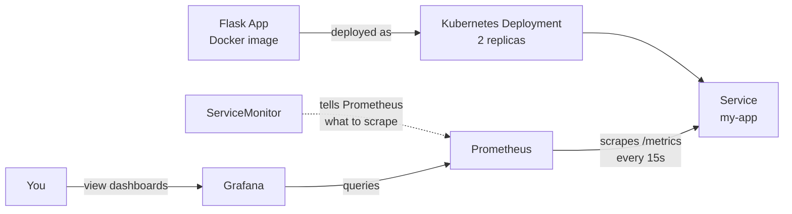


**How it works:**

1. The Flask app serves a web page and a `/metrics` endpoint.
2. Docker packages the app into an image.
3. Kubernetes runs 2 copies (pods) of the image and exposes them through a Service.
4. A `ServiceMonitor` tells Prometheus to scrape the Service every 15 seconds.
5. Grafana reads the data from Prometheus and displays dashboards.

---

## Tech Stack

| Tool | Purpose |
|---|---|
| Python + Flask | Sample web application |
| prometheus-client | Exposes app metrics at `/metrics` |
| Docker | Containerization |
| kind | Local Kubernetes cluster (Kubernetes in Docker) |
| kubectl | Kubernetes command-line tool |
| Helm | Installs the monitoring stack |
| Prometheus | Metrics collection and storage |
| Grafana | Dashboards and visualization |

---

## Project Structure

```
k8s-monitoring-project/
├── app.py                  # Flask app with Prometheus metrics
├── requirements.txt        # Python dependencies
├── Dockerfile              # Container image definition
├── k8s/
│   ├── app.yaml            # Deployment + Service
│   └── servicemonitor.yaml # Tells Prometheus to scrape the app
├── docs/
│   └── screenshots/        # Screenshots used in this README
└── README.md
```

---

## Prerequisites

Install these tools and make sure each command prints a version:

```bash
docker --version
kind --version
kubectl version --client
helm version
```

**Recommended:** at least 4 GB of RAM allocated to Docker. On Windows, use WSL2.

---

## Getting Started

### 1. Clone the repository

```bash
git clone https://github.com/<your-username>/k8s-monitoring-project.git
cd k8s-monitoring-project
```

### 2. Build and test the Docker image

```bash
docker build -t my-app:1.0 .
docker run -d -p 5000:5000 --name test-app my-app:1.0
curl localhost:5000
curl localhost:5000/metrics
docker rm -f test-app
```

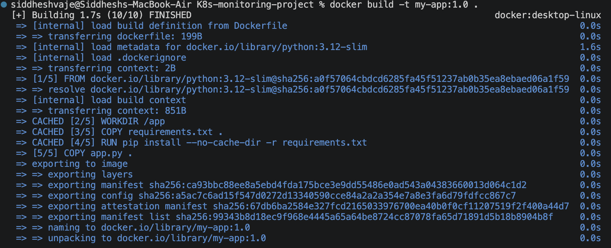
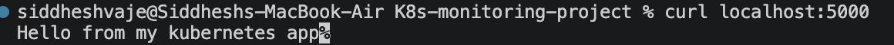

### 3. Create the Kubernetes cluster

```bash
kind create cluster --name demo
kubectl get nodes
```

The node should show `Ready`.

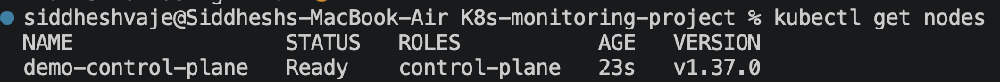

### 4. Load the image into the cluster

```bash
kind load docker-image my-app:1.0 --name demo
```

kind cannot see images on your machine automatically, so this step is required. A production setup would push to a registry such as Docker Hub or ECR.

### 5. Deploy the app

```bash
kubectl apply -f k8s/app.yaml
kubectl get pods
kubectl get svc
kubectl port-forward svc/my-app 8080:80
```

Open <http://localhost:8080>. Leave the port-forward running and use a new terminal for the next steps.

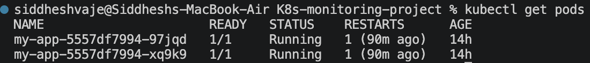
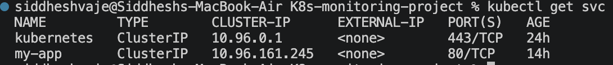

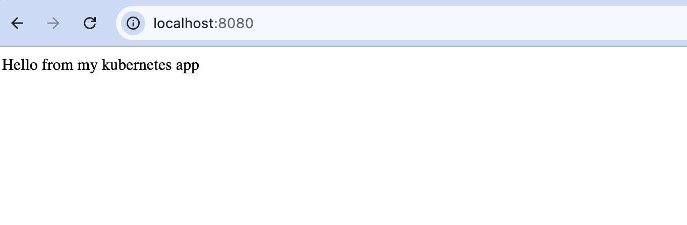

### 6. Install Prometheus and Grafana

```bash
helm repo add prometheus-community https://prometheus-community.github.io/helm-charts
helm repo update
helm install monitoring prometheus-community/kube-prometheus-stack \
  --namespace monitoring --create-namespace
```

Wait a few minutes, then check:

```bash
kubectl get pods -n monitoring
```

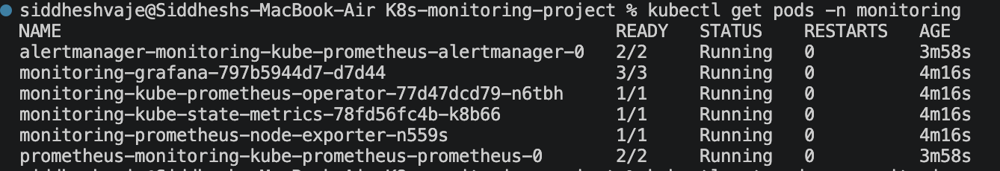

### 7. Tell Prometheus to scrape the app

```bash
kubectl apply -f k8s/servicemonitor.yaml
```

> **Important:** the ServiceMonitor must have the label `release: monitoring` (matching the Helm release name), otherwise Prometheus ignores it.

### 8. Verify in Prometheus

```bash
kubectl port-forward -n monitoring svc/monitoring-kube-prometheus-prometheus 9090:9090
```

Open <http://localhost:9090>, go to **Status → Targets**, and confirm `my-app` shows **UP**. Then run the query `app_requests_total` in the Graph tab.

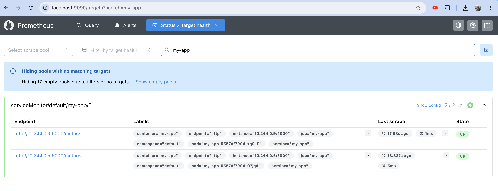

### 9. Generate traffic and open Grafana

Generate traffic (keep the app port-forward from step 5 running):

```bash
while true; do curl -s localhost:8080 > /dev/null; sleep 0.2; done
```

Open Grafana:

```bash
kubectl port-forward -n monitoring svc/monitoring-grafana 3000:80
```

Go to <http://localhost:3000>. The username is `admin`. Get the password:

```bash
kubectl get secret -n monitoring monitoring-grafana -o jsonpath="{.data.admin-password}" | base64 -d
```

Then create a dashboard (**Dashboards → New → New dashboard → Add visualization → Prometheus**) using the queries below.

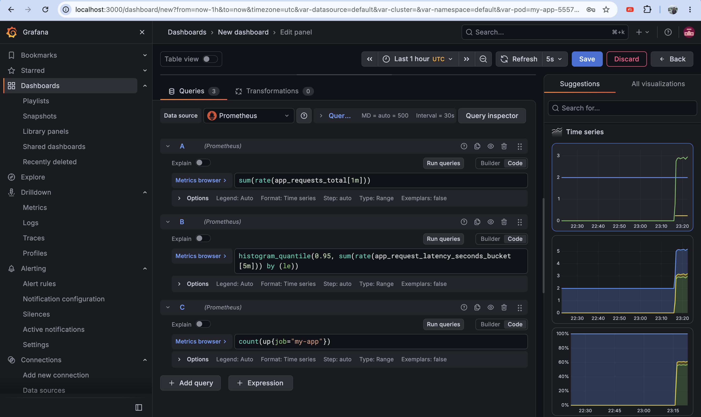

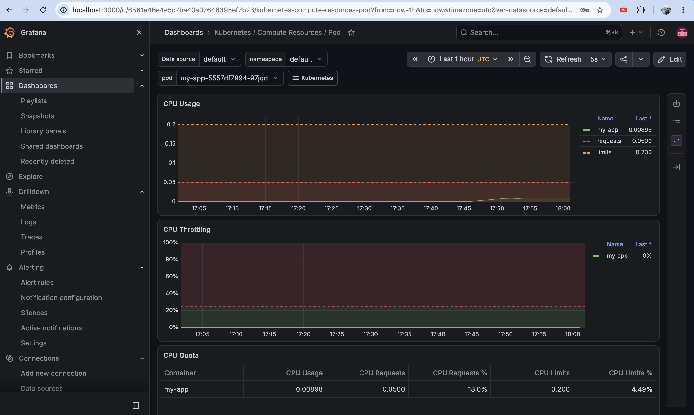

---

## Grafana Queries

| Panel | PromQL query |
|---|---|
| Requests per second | `sum(rate(app_requests_total[1m]))` |
| 95th percentile latency | `histogram_quantile(0.95, sum(rate(app_request_latency_seconds_bucket[5m])) by (le))` |
| Running pods | `count(up{job="my-app"})` |

---

## Cleanup

```bash
kind delete cluster --name demo
```

---

## What I Learned

- How to package an application into a Docker image
- The core Kubernetes objects: Deployment, Service, labels and selectors
- How readiness probes and resource requests/limits work
- How Prometheus scrapes metrics and how a ServiceMonitor configures it
- How to write basic PromQL queries and build Grafana dashboards
- How Kubernetes handles scaling, self-healing, and rolling updates

---

## Author

**Siddhesh Vaje**
GitHub: https://github.com/Siddheshvaje53
LinkedIn: www.linkedin.com/in/siddhesh-vaje